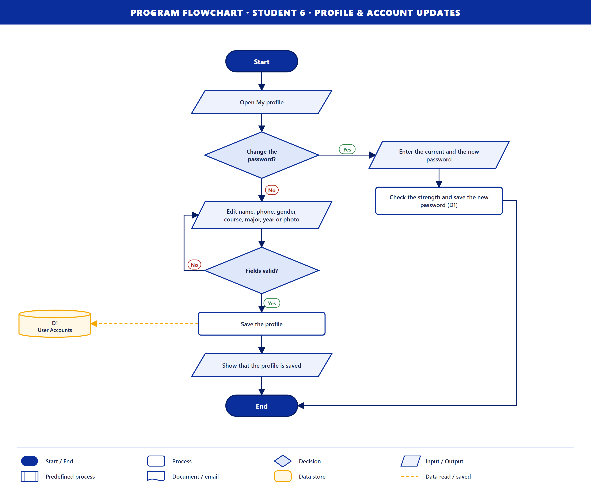
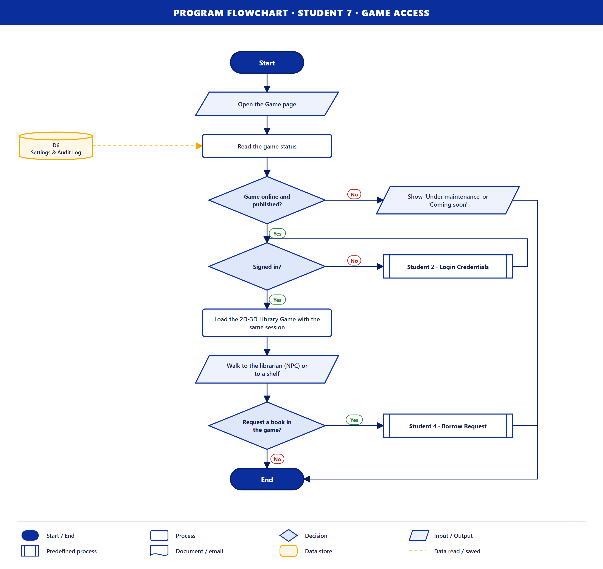
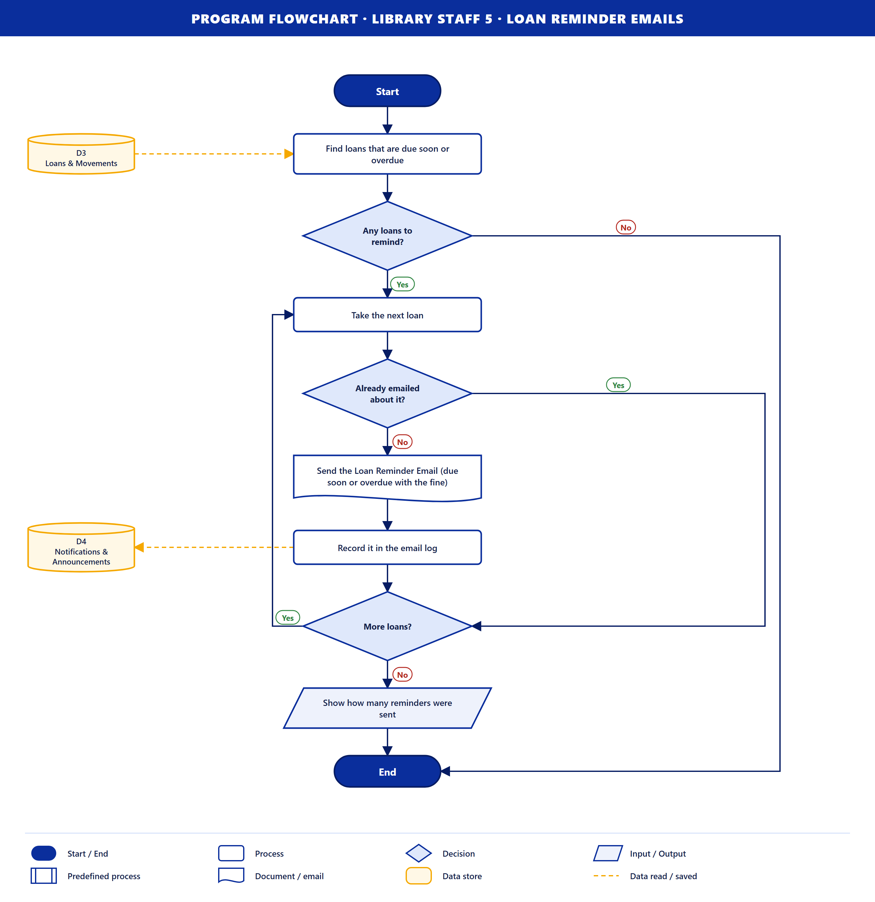
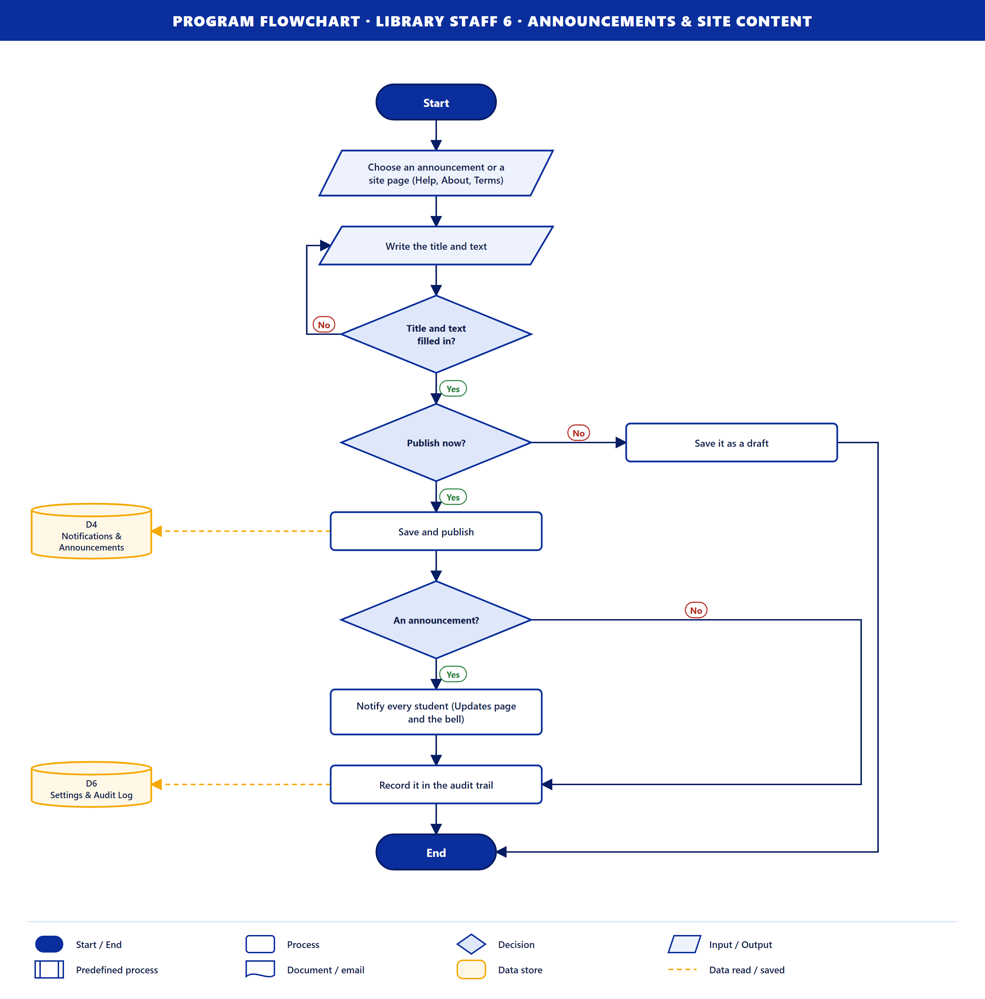
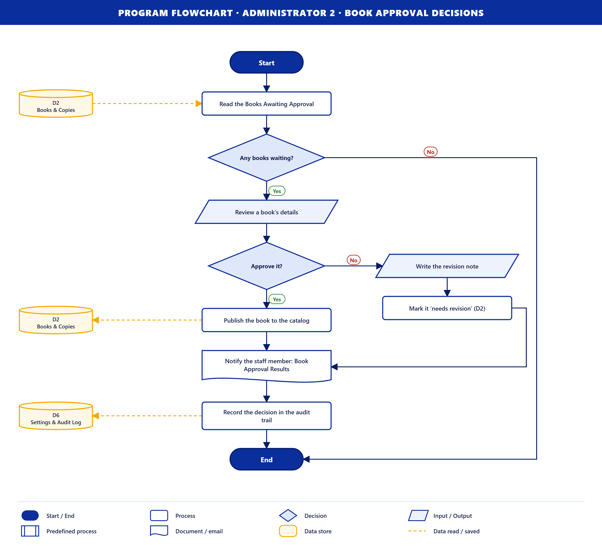
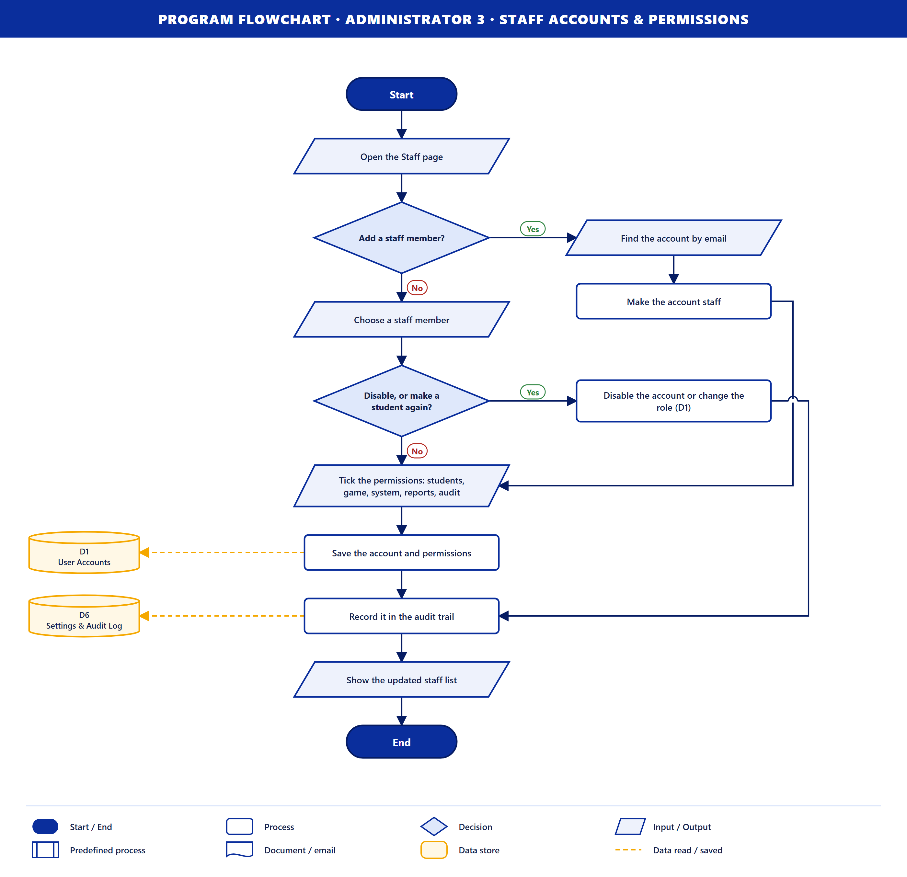
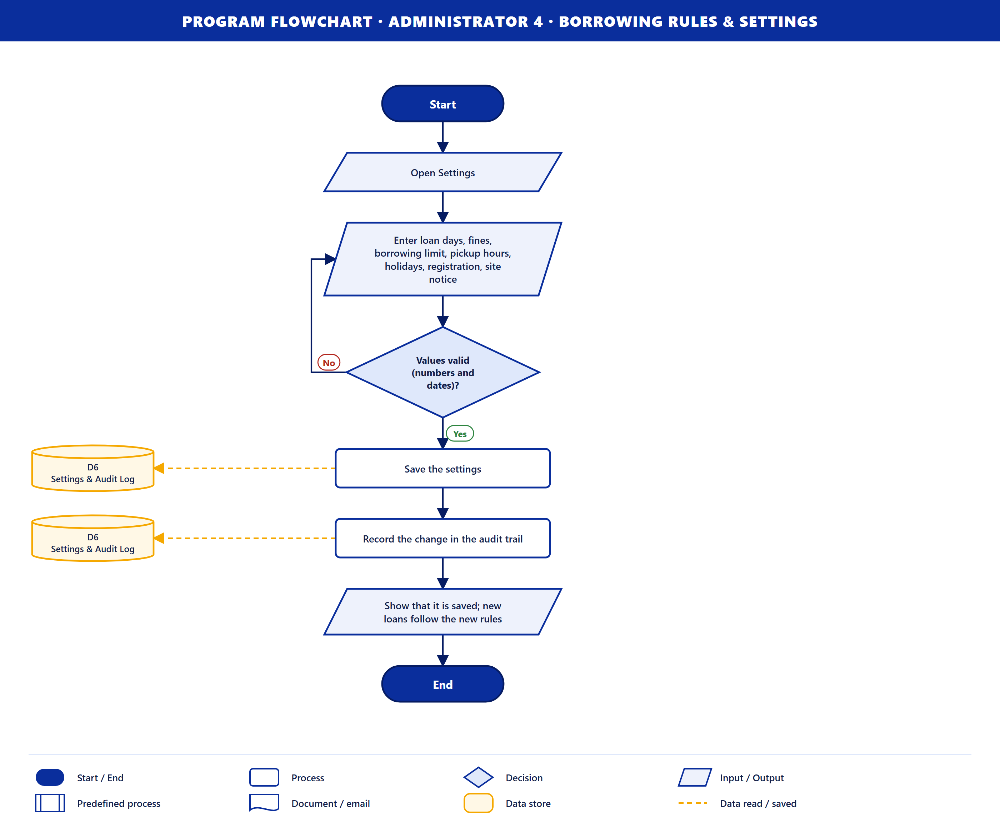
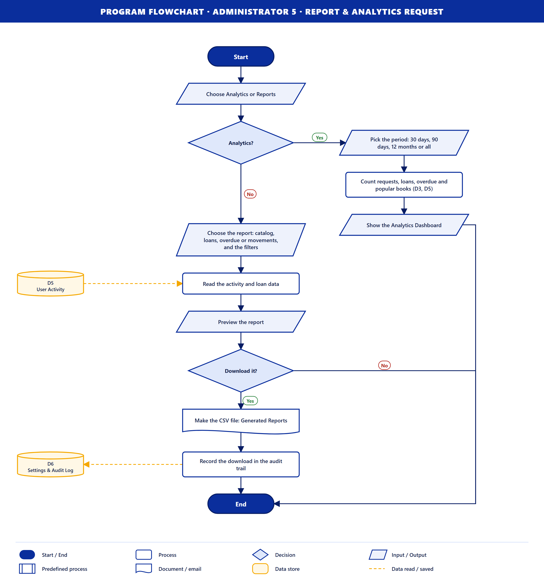

# Program Flowcharts of the CMU Library Explorer

This document explains the program flowcharts of the CMU Library Explorer, a web-based library catalog, book borrowing and circulation management system with a 2D-3D library game.

Each flowchart follows one **data flow that goes into the system** in the Level 0 Data Flow Diagram (`dfd-level0.png`). The Level 0 diagram has 18 such inputs:

| User | Inputs into the system | Flowcharts |
|---|---|---|
| Student | 7 | Registration Details, Login Credentials, View Catalog, Borrow Request, Request Cancellation, Profile & Account Updates, Game Access |
| Library Staff | 6 | Login Credentials, Manage Book, Pickup QR Scan (Checkout), Book Returns, Loan Reminder Emails, Announcements & Site Content |
| Administrator | 5 | Login Credentials, Book Approval Decisions, Staff Accounts & Permissions, Borrowing Rules & Settings, Report & Analytics Request |

Each flowchart shows how the system handles that input:

- what the user enters
- the checks the system makes
- the data stores it reads from or saves to
- what it sends back to the user

The data stores use the same numbers as the Level 1 Data Flow Diagram (`dfd-level1.png`).

## How to read the flowcharts

| Symbol | Meaning |
|---|---|
| Blue rounded bar | **Start / End** of the program |
| Rectangle | **Process**: something the system does |
| Diamond | **Decision**: a Yes/No check; the answer decides which line to follow |
| Slanted box | **Input / Output**: something the user enters or the system shows |
| Box with double sides | **Predefined process**: another flowchart is run at this point |
| Box with a wavy bottom | **Document / email**: a ticket, email or file the system produces |
| Gold cylinder | **Data store**: where data is kept (D1 to D6) |
| Dashed gold line | Data being **read** from (arrow points to the process) or **saved** to (arrow points to the store) a data store |

The main steps run down the middle. A **No** line that goes back up on the left side is a **loop**: the user corrects the input and the check runs again. Side branches on the right handle the other answer of a decision and then rejoin the main flow or go to End. Where two lines cross, the crossing line hops over the other one so they do not look joined.

**Data stores used**

| Store | Name | Holds |
|---|---|---|
| D1 | User Accounts | Accounts, student profiles, roles and permissions |
| D2 | Books & Copies | Book records, copy codes, approval status and archive details |
| D3 | Loans & Movements | Book requests, loans, due dates, returns and book movements |
| D4 | Notifications & Announcements | In-app notifications, announcements and the email log |
| D5 | User Activity | Activity and usage data used for reports and analytics |
| D6 | Settings & Audit Log | Borrowing rules, site settings and the audit trail |

---

# Part 1. Student

## Student 1 · Registration Details

**Purpose.** A new student creates a library account. The same account is used on the website and in the 2D-3D library game.

**Input.** Registration Details: username, email, password, student ID, course and year level.

**How it works**

1. The system reads the registration setting from **D6 Settings & Audit Log**. If registration is closed, the system shows that it is closed and the flow ends.
2. The student enters the registration details.
3. **All fields valid and password strong?** If not, the errors are shown under the fields and the student enters the details again (loop).
4. The system checks **D1 User Accounts** to make sure the username and email are not already taken. If either is taken, the student goes back to the form (loop).
5. The system emails a **6-digit verification code** to the student.
6. The student enters the code. **Code correct?** If not, the student enters it again (loop).
7. The account and student profile are saved to **D1 User Accounts**.
8. The system shows that the account is ready and takes the student to Sign in.

**Output.** A new student account, and the message that it is ready.

**Data stores.** D6 (read the registration setting), D1 (check that the username and email are free, then save the new account).

## Student 2 · Login Credentials

**Purpose.** A student signs in to use the library.

**Input.** Login Credentials: email and password.

**How it works**

1. The student enters the email and password.
2. **Sign-in locked for this email?** After too many wrong passwords, sign-in for that email is locked for a while. If it is locked, the system shows the time left until the lock ends, and the flow ends.
3. The system checks the email and password against **D1 User Accounts**.
4. **Credentials valid?** If not, the failed try is counted (too many tries lock the sign-in) and the student enters the credentials again (loop).
5. **Account active?** A disabled account cannot sign in. The system shows that the account is disabled, and the flow ends.
6. The system starts the session and loads the student profile from D1.
7. The student catalog (Discover) opens.

**Output.** A signed-in session and the Discover page.

**Data stores.** D1 (read the account to check the credentials and load the profile).

## Student 3 · View Catalog

**Purpose.** A student searches the catalog and looks at a book.

**Input.** View Catalog: search words, subject and availability filter.

**How it works**

1. The student enters search words, picks a subject and chooses an availability filter (all books, free now, all out).
2. The system searches **D2 Books & Copies**.
3. **Any books found?** If not, the system shows "Nothing matched" and suggests using fewer words, and the flow ends.
4. The system shows the book cards with the number of copies free and the student's own status, for example "You requested this".
5. **Open a book?** If the student does not open one, the flow ends.
6. The system reads the book's details and copies free from D2.
7. The system shows the book details: author, ISBN, shelf, loan period and availability.

**Output.** View Catalog: the list of matching books and the details of the chosen book.

**Data stores.** D2 (read the books and copies).

## Student 4 · Borrow Request

**Purpose.** A student reserves a book to pick up at the library. This works on the website and inside the 2D-3D library game.

**Input.** Borrow Request: the student presses "Request to borrow".

**How it works**

1. The student presses Request to borrow on the website or in the game.
2. The system counts the student's open loans and the copies free, using **D3 Loans & Movements**.
3. **A copy free?** If no copy is free, the system shows that the book is not available, and the flow ends.
4. **Under the borrowing limit and not already requested?** If the student already has the most books allowed, or already requested this book, the system shows the limit message, and the flow ends.
5. The system reserves a copy and saves the loan as **requested** with a pickup code in D3.
6. The system makes the **Pickup QR Ticket** and emails it to the student.
7. The ticket is shown in My books and in the game. The student must pick up the book within 2 days.

**Output.** Book Request and the Pickup QR Ticket (on screen and by email).

**Data stores.** D3 (read the open loans, then save the new request).

## Student 5 · Request Cancellation

**Purpose.** A student cancels a book request they no longer need.

**Input.** Request Cancellation: the student presses Cancel on a request in My books.

**How it works**

1. The student opens My books and presses Cancel on a request.
2. The system reads the loan from **D3 Loans & Movements**.
3. **Still requested (not picked up)?** A book that was already picked up cannot be cancelled. The system shows that it can no longer be cancelled, and the flow ends.
4. **Student confirms?** If the student does not confirm, nothing changes and the flow ends.
5. The loan is marked **cancelled** in D3, and the copy goes back on the shelf for other students.
6. The system emails a cancellation notice.
7. The request now appears under History in My books.

**Output.** The cancelled request, a cancellation email, and the updated History.

**Data stores.** D3 (read the loan, then save it as cancelled).

## Student 6 · Profile & Account Updates

**Purpose.** A student keeps their profile and password up to date.

**Input.** Profile & Account Updates.

**How it works**

1. The student opens My profile.
2. **Change the password?** If yes, the student enters the current password and the new one. The system checks the new password's strength and saves it to D1, and the flow ends.
3. Otherwise the student edits their name, phone, gender, course, major, year level or photo.
4. **Fields valid?** If not, the student corrects them (loop).
5. The profile is saved to **D1 User Accounts**.
6. The system shows that the profile is saved.

**Output.** The updated profile or password.

**Data stores.** D1 (save the profile or the new password).

## Student 7 · Game Access

**Purpose.** A student enters the 2D-3D library game with the same library account.

**Input.** Game Access: the student opens the Game page.

**How it works**

1. The student opens the Game page.
2. The system reads the game status from **D6 Settings & Audit Log**.
3. **Game online and published?** If the game is under maintenance or not published yet, the system shows "Under maintenance" or "Coming soon", and the flow ends.
4. **Signed in?** If not, the **Student 2 · Login Credentials** flowchart runs, and then the check is made again.
5. The system loads the **2D-3D Library Game** with the same session, so the student does not sign in twice.
6. In the game, the student walks to the librarian (NPC) or to a shelf.
7. **Request a book in the game?** If yes, the **Student 4 · Borrow Request** flowchart runs, so the student can request a book and get the QR ticket inside the game.

**Output.** The 2D-3D Library Game, and a Book Request if the student borrows in the game.

**Data stores.** D6 (read the game status). The login and the request use D1 and D3 through the flowcharts they call.

---

# Part 2. Library Staff

## Library Staff 1 · Login Credentials

**Purpose.** A staff member signs in to the staff panel.

**Input.** Login Credentials: email and password.

**How it works.** The steps are the same as **Student 2 · Login Credentials**:

1. The lock check runs first.
2. The credentials are checked against **D1 User Accounts**, and failed tries are counted.
3. The account must be active.

After a successful sign-in, the system loads the staff member's **role and permissions** and opens the **staff dashboard**. The dashboard only shows the tabs the staff member is allowed to use, for example Students or Reports.

**Output.** A signed-in session and the staff dashboard.

**Data stores.** D1 (read the account, role and permissions).

## Library Staff 2 · Manage Book

**Purpose.** A staff member adds a new book, edits a book or archives one.

**Input.** Manage Book.

**How it works**

1. The staff member chooses Add, Edit or Archive.
2. **Archive?** If yes, the staff member chooses where the book is kept and why. The book is moved to the archive in D2, and the flow continues at the audit trail step.
3. For Add or Edit, the staff member enters the details: ISBN, title, authors, edition, subject, copies and cover.
4. **ISBN valid and not a duplicate?** If not, the staff member corrects the details (loop).
5. **Copies not below those on loan?** The number of copies cannot be lower than the copies already borrowed. If it is, the staff member corrects it (loop).
6. The book and its copy codes are saved to **D2 Books & Copies**.
7. The book is kept out of the catalog, and the administrators are notified that it is waiting for approval.
8. The **Book Approval Results** arrive later as a notification, after an administrator decides (see Administrator 2).
9. The change is recorded in the audit trail in **D6 Settings & Audit Log**.

**Output.** The saved or archived book, and later the Book Approval Results.

**Data stores.** D2 (save the book or the archive), D6 (record the change in the audit trail).

## Library Staff 3 · Pickup QR Scan (Checkout)

**Purpose.** A staff member gives a reserved book to the student at the library desk.

**Input.** Pickup QR Scan: the staff member scans the QR code on the student's ticket.

**How it works**

1. The staff member scans the student's QR ticket with the camera, or types the code.
2. The system looks up the ticket's loans in **D3 Loans & Movements**.
3. **Ticket found?** If not, the system shows that the ticket was not found, and the flow ends.
4. **Still requested and within 2 days?** If the request expired or was cancelled, the system says so, and the flow ends.
5. The system shows the student and the books on the ticket.
6. The book is checked out: the loan becomes **borrowed** in D3 and the due date is set. Fiction books get 5 days and Circulation/Reserve books get 3 days; weekends and holidays are skipped.
7. The system emails the student the due dates.
8. The Circulation & Movement Records are updated.

**Output.** The checked-out loan, the due-date email to the student, and the updated Circulation & Movement Records.

**Data stores.** D3 (read the ticket's loans, then save the checkout).

## Library Staff 4 · Book Returns

**Purpose.** A staff member records a book that a student brings back.

**Input.** Book Returns.

**How it works**

1. The staff member scans the ticket or searches for the loan.
2. The system reads the loan from **D3 Loans & Movements**.
3. **Borrowed and not yet returned?** If the book was already returned, the system says so, and the flow ends.
4. **Returned late?** If yes, the system works out the fine for each late weekday.
5. The loan is marked **returned** and the movement is logged in D3. The copy goes back on the shelf.
6. The system emails the student a return receipt.
7. The Circulation & Movement Records are updated.

**Output.** The returned loan, any fine, a receipt email and the updated Circulation & Movement Records.

**Data stores.** D3 (read the loan, then save the return and the movement).

## Library Staff 5 · Loan Reminder Emails

**Purpose.** Students are reminded before a book is due and when it is overdue.

**Input.** Loan Reminder Emails.

**How it works**

1. The system finds the loans that are due soon or overdue in **D3 Loans & Movements**.
2. **Any loans to remind?** If not, the flow ends.
3. The system takes the next loan.
4. **Already emailed about it?** If yes, it is skipped so the student is not emailed twice.
5. The system sends the **Loan Reminder Email**: due soon, or overdue with the fine so far.
6. The email is recorded in the email log in **D4 Notifications & Announcements**.
7. **More loans?** If yes, the system goes back to step 3 (loop) until every loan has been handled.
8. The system shows how many reminders were sent.

**Output.** Reminder emails to the students, and the number of reminders sent.

**Data stores.** D3 (read the loans that are due), D4 (save each email in the email log).

## Library Staff 6 · Announcements & Site Content

**Purpose.** A staff member posts an announcement or updates a site page.

**Input.** Announcements & Site Content.

**How it works**

1. The staff member chooses an announcement or a site page (Help, About or Terms).
2. The staff member writes the title and text.
3. **Title and text filled in?** If not, the staff member completes them (loop).
4. **Publish now?** If not, it is saved as a draft, and the flow ends.
5. The announcement or page is saved and published in **D4 Notifications & Announcements**.
6. **An announcement?** If yes, every student is notified on the Updates page and by the bell icon. A site page is simply updated.
7. The change is recorded in the audit trail in **D6 Settings & Audit Log**.

**Output.** The published announcement or page, and notices to the students.

**Data stores.** D4 (save and publish), D6 (record it in the audit trail).

---

# Part 3. Administrator

## Administrator 1 · Login Credentials

**Purpose.** The administrator signs in to manage the library system.

**Input.** Login Credentials: email and password.

**How it works.** The steps are the same as **Student 2 · Login Credentials**:

1. The lock check runs first.
2. The credentials are checked against **D1 User Accounts**, and failed tries are counted.
3. The account must be active.

After a successful sign-in, the system loads the **admin role** and opens the **admin dashboard**, which shows every module.

**Output.** A signed-in session and the admin dashboard.

**Data stores.** D1 (read the account and role).

## Administrator 2 · Book Approval Decisions

**Purpose.** The administrator checks the books that staff added before they appear in the catalog.

**Input.** Book Approval Decisions.

**How it works**

1. The system reads the **Books Awaiting Approval** from **D2 Books & Copies**.
2. **Any books waiting?** If not, the flow ends.
3. The administrator reviews a book's details.
4. **Approve it?**
   - **Yes:** the book is published to the catalog in D2, and students can now find and borrow it.
   - **No:** the administrator writes a revision note, and the book is marked **needs revision** in D2.
5. The staff member who added the book is notified with the **Book Approval Results**.
6. The decision is recorded in the audit trail in **D6 Settings & Audit Log**.

**Output.** Book Approval Results, sent to the staff member.

**Data stores.** D2 (read the waiting books, then save the decision), D6 (record the decision in the audit trail).

## Administrator 3 · Staff Accounts & Permissions

**Purpose.** The administrator manages who works in the staff panel and what each staff member can do.

**Input.** Staff Accounts & Permissions.

**How it works**

1. The administrator opens the Staff page.
2. **Add a staff member?** If yes, the administrator finds the account by email and makes it a staff account. The flow then continues at the permissions step.
3. Otherwise, the administrator chooses an existing staff member.
4. **Disable, or make a student again?** If yes, the account is disabled or its role is changed in D1, and the flow continues at the audit trail step.
5. The administrator ticks the permissions the staff member may use: Students, Game, System, Reports and Audit.
6. The account and permissions are saved to **D1 User Accounts**.
7. The change is recorded in the audit trail in **D6 Settings & Audit Log**.
8. The system shows the updated staff list.

**Output.** The updated staff account and permissions, and the staff list.

**Data stores.** D1 (save the account, role and permissions), D6 (record the change in the audit trail).

## Administrator 4 · Borrowing Rules & Settings

**Purpose.** The administrator sets the rules that every loan follows.

**Input.** Borrowing Rules & Settings.

**How it works**

1. The administrator opens Settings.
2. The administrator enters the values:
   - loan days and fines for each material type
   - the borrowing limit and the pickup hours
   - holidays
   - whether registration is open
   - the site notice
3. **Values valid (numbers and dates)?** If not, the administrator corrects them (loop).
4. The settings are saved to **D6 Settings & Audit Log**.
5. The change is recorded in the audit trail in D6.
6. The system shows that the settings are saved. New loans follow the new rules.

**Output.** The saved settings, and the confirmation.

**Data stores.** D6 (save the settings and record the change in the audit trail).

## Administrator 5 · Report & Analytics Request

**Purpose.** The administrator sees how the library is used and downloads reports.

**Input.** Report & Analytics Request.

**How it works**

1. The administrator chooses Analytics or Reports.
2. **Analytics?** If yes:
   1. The administrator picks the period: 30 days, 90 days, 12 months or all time.
   2. The system counts the requests, loans, overdue books and popular books from D3 and D5.
   3. The system shows the **Analytics Dashboard**, and the flow ends.
3. For Reports, the administrator chooses the report (catalog, loans, overdue or movements) and the filters.
4. The system reads the activity and loan data from **D5 User Activity**.
5. The system shows a preview of the report.
6. **Download it?** If not, the flow ends.
7. The system makes the **CSV file** (Generated Reports), which opens in a spreadsheet.
8. The download is recorded in the audit trail in **D6 Settings & Audit Log**.

**Output.** The Analytics Dashboard, or the Generated Reports as a CSV file.

**Data stores.** D5 (read the activity data; D3 is also read for analytics), D6 (record the download in the audit trail).

---

## Summary

| No. | Flowchart | User | Main data stores | Output to the user |
|---|---|---|---|---|
| 1 | Registration Details | Student | D6, D1 | New account |
| 2 | Login Credentials | Student | D1 | Session and Discover page |
| 3 | View Catalog | Student | D2 | Book list and book details |
| 4 | Borrow Request | Student | D3 | Book Request and Pickup QR Ticket |
| 5 | Request Cancellation | Student | D3 | Cancelled request and email |
| 6 | Profile & Account Updates | Student | D1 | Updated profile or password |
| 7 | Game Access | Student | D6 (D1, D3) | 2D-3D Library Game |
| 8 | Login Credentials | Library Staff | D1 | Session and staff dashboard |
| 9 | Manage Book | Library Staff | D2, D6 | Saved book, later Book Approval Results |
| 10 | Pickup QR Scan (Checkout) | Library Staff | D3 | Checked-out loan and due dates |
| 11 | Book Returns | Library Staff | D3 | Return, fine and receipt |
| 12 | Loan Reminder Emails | Library Staff | D3, D4 | Reminder emails |
| 13 | Announcements & Site Content | Library Staff | D4, D6 | Published announcement or page |
| 14 | Login Credentials | Administrator | D1 | Session and admin dashboard |
| 15 | Book Approval Decisions | Administrator | D2, D6 | Book Approval Results |
| 16 | Staff Accounts & Permissions | Administrator | D1, D6 | Updated staff list |
| 17 | Borrowing Rules & Settings | Administrator | D6 | Saved settings |
| 18 | Report & Analytics Request | Administrator | D5, D3, D6 | Analytics Dashboard or CSV report |

The flowcharts are drawn by `tools/make-program-flowcharts.mjs`. To change a step, edit its list in that file and run `node tools/make-program-flowcharts.mjs`; every chart is redrawn into `docs/program-flowcharts/`.
