# Program Flowcharts of the CMU Library Explorer

This document explains the program flowcharts of the CMU Library Explorer, a web-based library catalog, book borrowing and circulation management system with a 2D-3D library game.

Each flowchart follows one **data flow** in the Level 0 Data Flow Diagram (`dfd-level0.png`). The Level 0 diagram has **24 data flows**: 12 that go **into** the system (what the user enters) and 12 that come **out** of it (what the system gives back).

| User | Into the system (in) | Out to the user (out) | Total |
|---|---|---|---|
| Student | 5: Registration Details, Login Credentials, View Catalog, Borrow Request, Request Cancellation | 4: 2D-3D Library Game, Pickup QR Ticket, Due Dates & Overdue Fines, Notifications & Email Reminders | 9 |
| Library Staff | 4: Login Credentials, Manage Book, Pickup QR Scan (Checkout), Book Returns | 4: Pending Borrow Requests, Circulation & Movement Records, Book Approval Results, Generated Reports | 8 |
| Administrator | 3: Login Credentials, Book Manage Request, Manage Users & Permission | 4: Book Manage Request, Analytics Dashboard, Audit Trail Logs, Generated Reports | 7 |
| **Total** | **12** | **12** | **24** |

An **in** flowchart starts with what the user enters and shows the checks the system makes before it saves anything. An **out** flowchart shows how the system gathers and works out the information it sends back to the user.

The data stores use the same numbers as the Level 1 Data Flow Diagram (`dfd-level1.png`).

## How to read the flowcharts

| Symbol | Meaning |
|---|---|
| Blue rounded bar | **Start / End** of the program |
| Rectangle | **Process**: something the system does |
| Diamond | **Decision**: a Yes/No check; the answer decides which line to follow |
| Slanted box | **Input / Output**: something the user enters or the system shows |
| Box with double sides | **Predefined process**: another flowchart is run at this point |
| Box with a wavy bottom | **Document / email**: a ticket, email or file the system produces |
| Gold cylinder | **Data store**: where data is kept (D1 to D6) |
| Dashed gold line | Data being **read** from (arrow points to the process) or **saved** to (arrow points to the store) a data store |

The main steps run down the middle. A **No** line that goes back up on the left side is a **loop**: the user corrects the input and the check runs again. Side branches on the right handle the other answer of a decision and then rejoin the main flow or go to End.

**Data stores used**

| Store | Name | Holds |
|---|---|---|
| D1 | User Accounts | Accounts, student profiles, roles and permissions |
| D2 | Books & Copies | Book records, copy codes, approval status and archive details |
| D3 | Loans & Movements | Book requests, loans, due dates, returns and book movements |
| D4 | Notifications & Announcements | In-app notifications, announcements and the email log |
| D5 | User Activity | Activity and usage data, including report downloads |
| D6 | Settings & Audit Log | Borrowing rules, site settings and the audit trail |

---

# Part 1. Student (9 flowcharts)

## Student 1 · Registration Details (in)

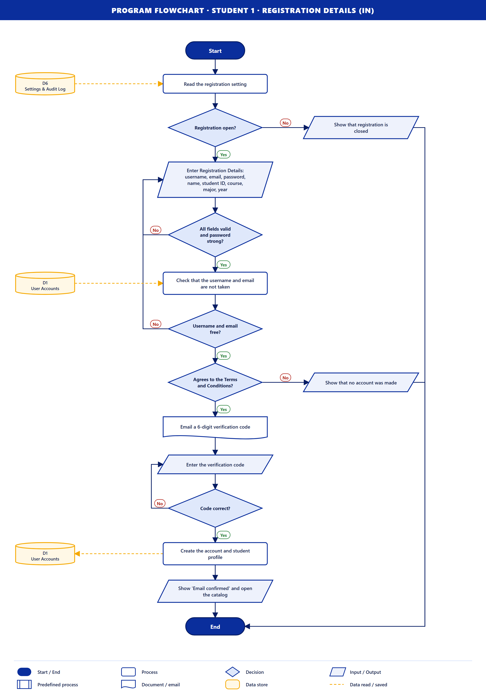

**Purpose.** A new student creates a library account. The same account is used on the website and in the game.

**How it works**

1. The system reads the registration setting from **D6**. If registration is closed, it says so and the flow ends.
2. The student enters the Registration Details: username, email, password, name, student ID, course, major and year level.
3. **All fields valid and password strong?** If not, the student corrects them (loop).
4. The system checks **D1** that the username and email are free. If not, back to the form (loop).
5. **Agrees to the Terms and Conditions?** If not, no account is made and the flow ends.
6. The system emails a 6-digit verification code. The student types it in; a wrong code is typed again (loop).
7. The account and student profile are saved to **D1**, and the catalog opens.

**Data stores.** D6 (read), D1 (read, then save).

## Student 2 · Login Credentials (in)

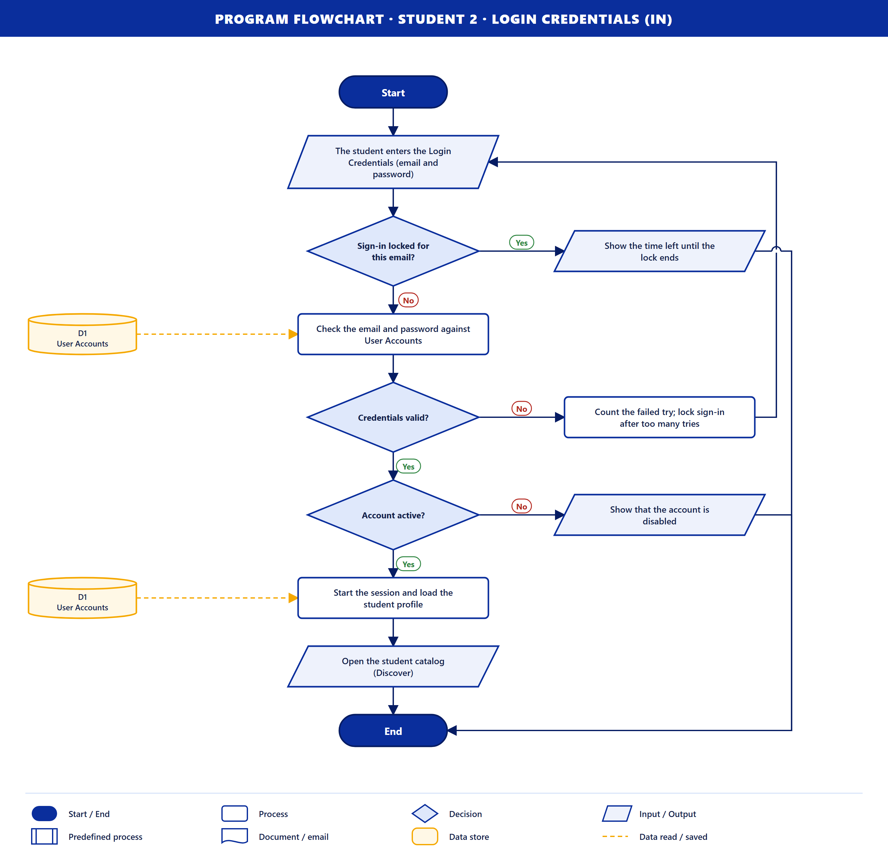

**Purpose.** A student signs in.

**How it works**

1. The student enters the email and password.
2. **Sign-in locked for this email?** After too many wrong passwords the email is locked for a while; the time left is shown and the flow ends.
3. The credentials are checked against **D1**. Wrong credentials are counted and the student tries again (loop).
4. **Account active?** A disabled account cannot sign in.
5. The session starts, the profile is loaded and the catalog (Discover) opens.

**Data stores.** D1 (read).

## Student 3 · View Catalog (in)

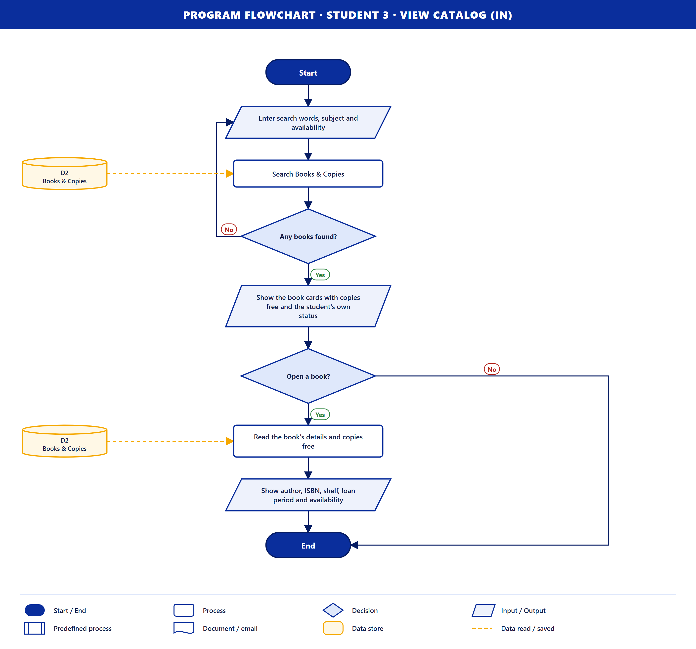

**Purpose.** A student searches the catalog and opens a book.

**How it works**

1. The student enters search words, a subject and availability.
2. The system searches **D2**. If nothing matches, the student searches again (loop).
3. The book cards show the copies free and the student's own status.
4. **Open a book?** If yes, the details are read from D2: author, ISBN, shelf, loan period and availability.

**Data stores.** D2 (read).

## Student 4 · Borrow Request (in)

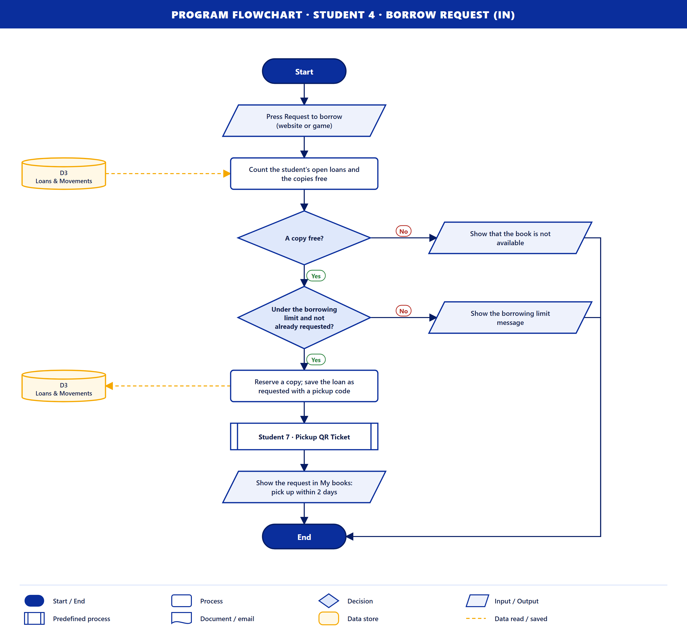

**Purpose.** A student asks to borrow a book, on the website or in the game.

**How it works**

1. The student presses Request to borrow.
2. The system counts the student's open loans and the copies free in **D3**.
3. **A copy free?** and **Under the borrowing limit and not already requested?** If either is No, the reason is shown and the flow ends.
4. A copy is reserved and the loan is saved as *requested* with a pickup code in **D3**.
5. **Student 7 · Pickup QR Ticket** runs, then the request shows in My books with the 2-day pickup window.

**Data stores.** D3 (read, then save).

## Student 5 · Request Cancellation (in)

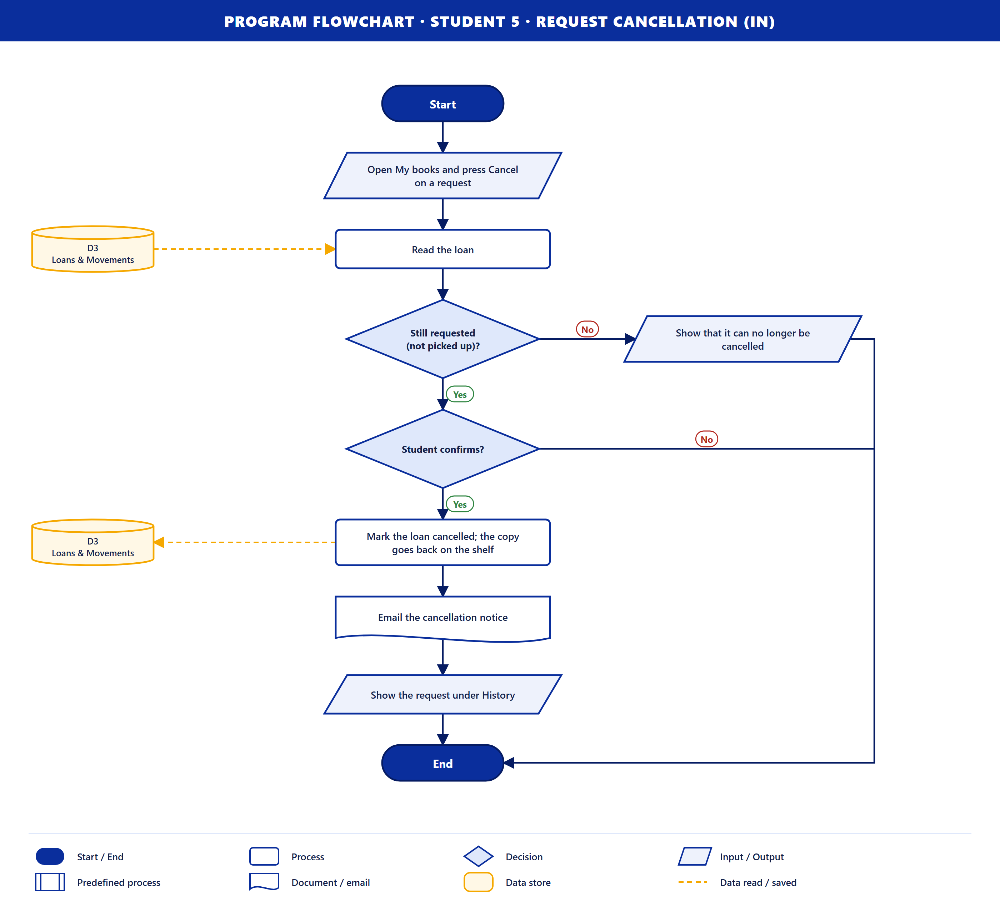

**Purpose.** A student cancels a request before picking the book up.

**How it works**

1. The student presses Cancel on a request in My books, and the loan is read from **D3**.
2. **Still requested (not picked up)?** If not, it can no longer be cancelled.
3. **Student confirms?** If not, nothing changes.
4. The loan is marked cancelled in **D3** and the copy goes back on the shelf.
5. A cancellation email is sent, and the request moves to History.

**Data stores.** D3 (read, then save).

## Student 6 · 2D-3D Library Game (out)

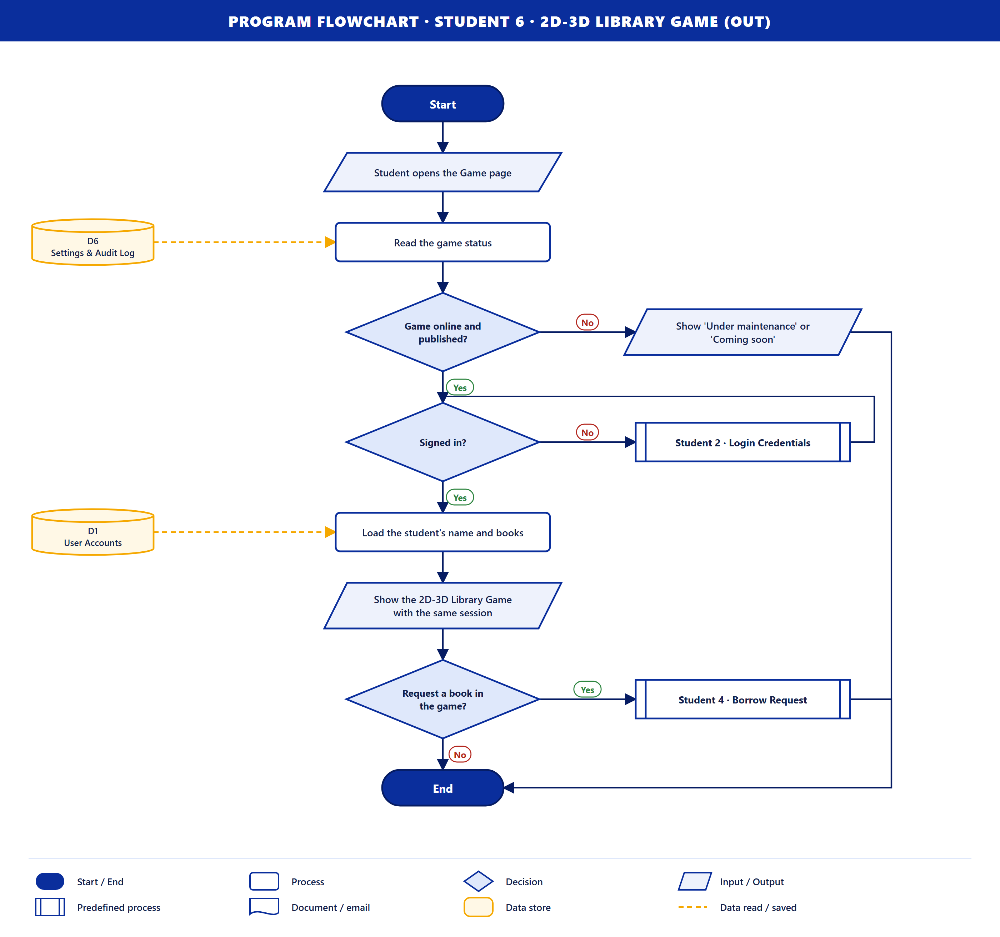

**Purpose.** The system gives the student the 2D-3D library game with the same account.

**How it works**

1. The student opens the Game page and the game status is read from **D6**.
2. **Game online and published?** If not, "Under maintenance" or "Coming soon" is shown.
3. **Signed in?** If not, **Student 2 · Login Credentials** runs first.
4. The student's name and books are loaded from **D1**, and the game opens with the same session.
5. **Request a book in the game?** If yes, **Student 4 · Borrow Request** runs.

**Data stores.** D6 (read), D1 (read).

## Student 7 · Pickup QR Ticket (out)

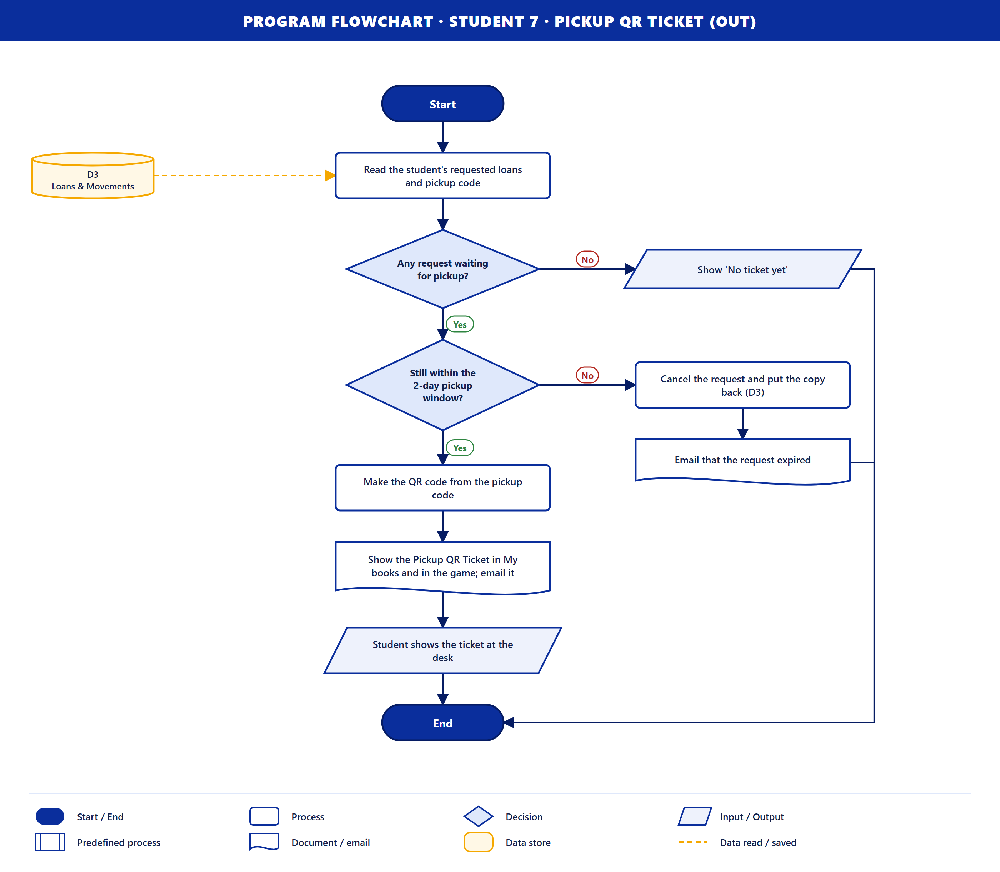

**Purpose.** The system gives the student the QR ticket to show at the desk.

**How it works**

1. The student's requested loans and pickup code are read from **D3**.
2. **Any request waiting for pickup?** If not, "No ticket yet" is shown.
3. **Still within the 2-day pickup window?** If not, the request is cancelled, the copy goes back (D3) and an "expired" email is sent.
4. The QR code is made from the pickup code.
5. The ticket is shown in My books and in the game, and emailed. The student shows it at the desk.

**Data stores.** D3 (read; save when a request expires).

## Student 8 · Due Dates & Overdue Fines (out)

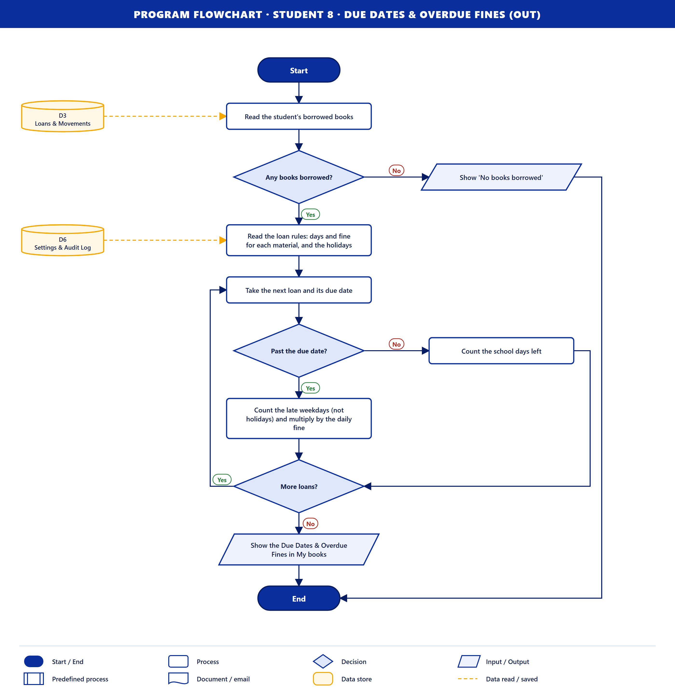

**Purpose.** The system shows the student when each book is due and any fine.

**How it works**

1. The student's borrowed books are read from **D3**. If there are none, "No books borrowed" is shown.
2. The loan rules (days and daily fine for each material) and the holidays are read from **D6**.
3. For each loan (loop): **Past the due date?** If No, the school days left are counted. If Yes, the late weekdays (not holidays) are multiplied by the daily fine.
4. The Due Dates & Overdue Fines are shown in My books.

**Data stores.** D3 (read), D6 (read).

## Student 9 · Notifications & Email Reminders (out)

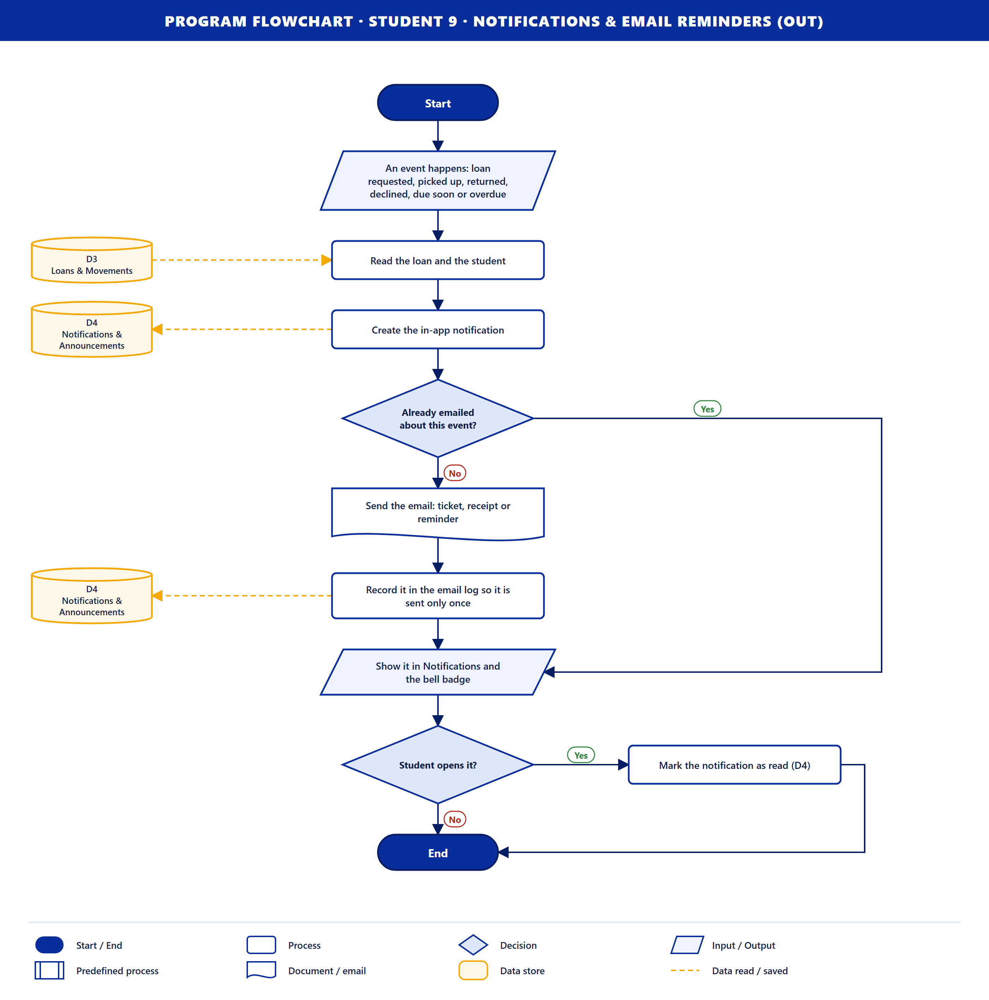

**Purpose.** The system tells the student about every change to their loans.

**How it works**

1. An event happens: a loan is requested, picked up, returned or declined, or a book is due soon or overdue.
2. The loan and student are read from **D3**, and an in-app notification is saved to **D4**.
3. **Already emailed about this event?** If not, the email is sent (ticket, receipt or reminder) and recorded in the email log in **D4**, so it is sent only once.
4. The notification shows in Notifications and on the bell badge. When the student opens it, it is marked read.

**Data stores.** D3 (read), D4 (save).

---

# Part 2. Library Staff (8 flowcharts)

## Library Staff 1 · Login Credentials (in)

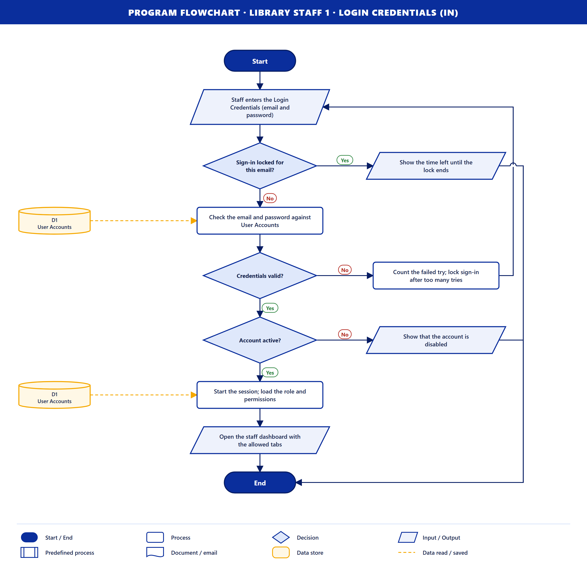

**Purpose.** A staff member signs in. The steps are the same as Student 2, but the system also loads the staff role and permissions from **D1** and opens the staff dashboard with only the allowed tabs.

**Data stores.** D1 (read).

## Library Staff 2 · Manage Book (in)

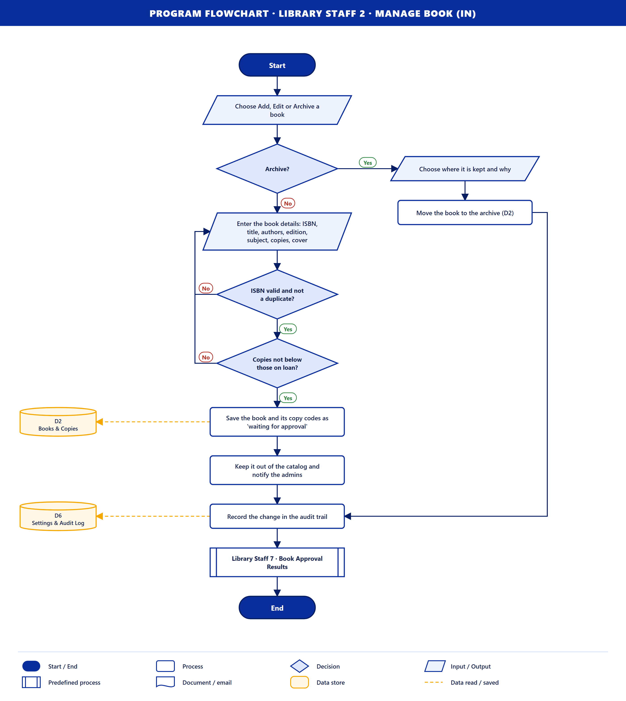

**Purpose.** Staff add, edit or archive a book.

**How it works**

1. Staff choose Add, Edit or Archive. **Archive?** If yes, they choose where the book is kept and why, and it moves to the archive in D2.
2. Otherwise they enter the book details: ISBN, title, authors, edition, subject, copies and cover.
3. **ISBN valid and not a duplicate?** and **Copies not below those on loan?** If not, they correct the form (loop).
4. The book and its copy codes are saved to **D2** as *waiting for approval*. It stays out of the catalog and the admins are notified.
5. The change is recorded in the audit trail in **D6**.
6. **Library Staff 7 · Book Approval Results** follows when the admin decides.

**Data stores.** D2 (save), D6 (save).

## Library Staff 3 · Pickup QR Scan (Checkout) (in)

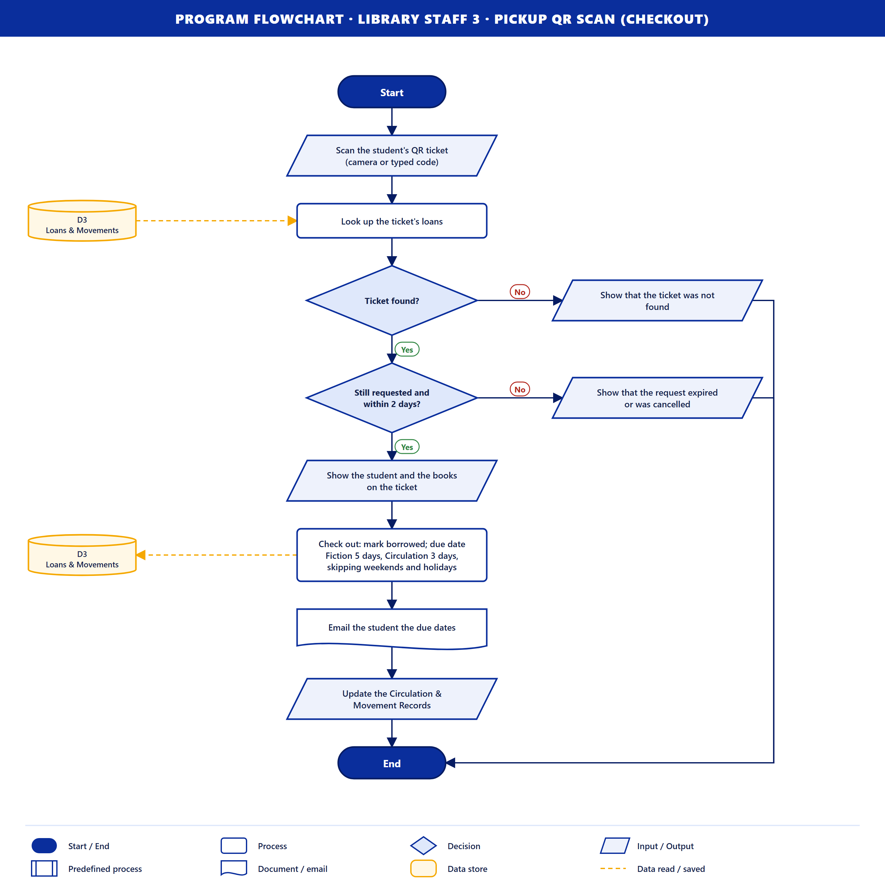

**Purpose.** Staff hand the book to the student by scanning the ticket.

**How it works**

1. Staff scan the QR ticket (camera or typed code) and the loans are read from **D3**. If the ticket is not found, they scan again (loop).
2. **Still requested and within 2 days?** If not, the system shows that it expired or was cancelled.
3. The student and books are shown, and the books are checked out in **D3**: the due date is Fiction 5 days, Circulation 3 days, counting school days only.
4. The student is emailed the due dates.

**Data stores.** D3 (read, then save).

## Library Staff 4 · Book Returns (in)

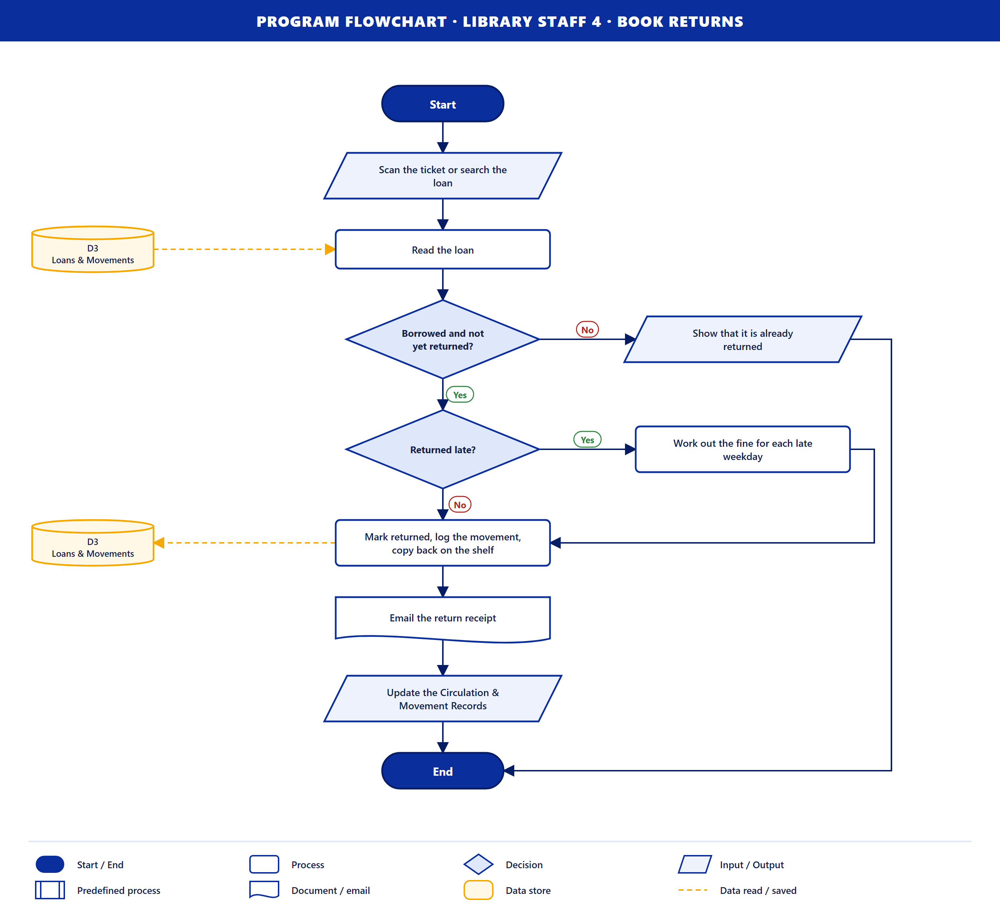

**Purpose.** Staff record a returned book.

**How it works**

1. Staff scan the ticket or search the loan, read from **D3**. If it is not a borrowed book, they search again (loop).
2. **Returned late?** If yes, the fine is worked out for each late weekday.
3. The loan is marked returned, the movement is logged and the copy goes back on the shelf in **D3**.
4. A return receipt is emailed.

**Data stores.** D3 (read, then save).

## Library Staff 5 · Pending Borrow Requests (out)

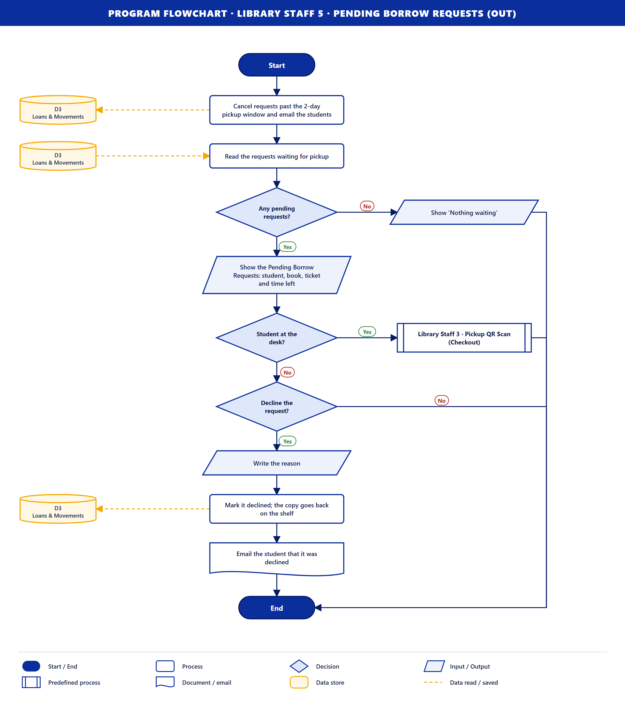

**Purpose.** The system shows staff the requests waiting for pickup.

**How it works**

1. Requests past the 2-day pickup window are cancelled in **D3** and the students are emailed.
2. The requests still waiting are read from **D3**. If there are none, "Nothing waiting" is shown.
3. The Pending Borrow Requests are shown: student, book, ticket and time left.
4. **Student at the desk?** If yes, **Library Staff 3 · Pickup QR Scan** runs.
5. **Decline the request?** If yes, staff write the reason, the loan is marked declined in D3 (the copy goes back) and the student is emailed.

**Data stores.** D3 (read, then save).

## Library Staff 6 · Circulation & Movement Records (out)

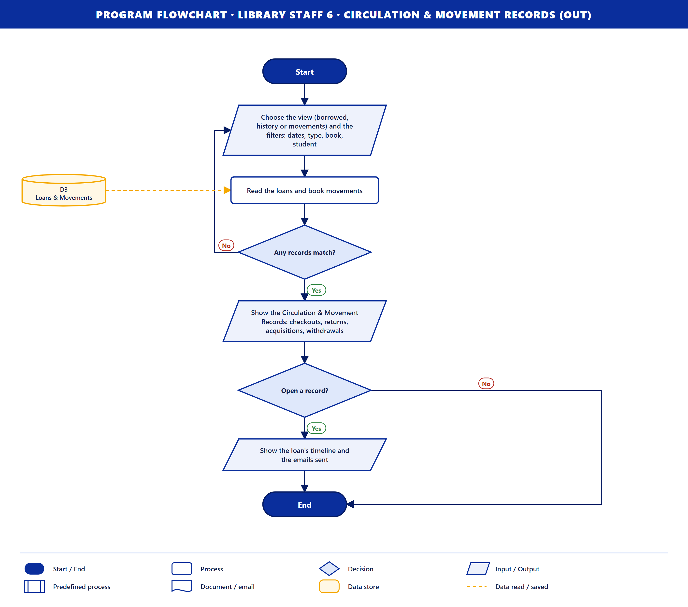

**Purpose.** The system shows staff the history of loans and book movements.

**How it works**

1. Staff choose the view (borrowed, history or movements) and the filters: dates, type, book, student.
2. The loans and movements are read from **D3**. If nothing matches, they change the filters (loop).
3. The records are shown: checkouts, returns, acquisitions and withdrawals.
4. **Open a record?** If yes, the loan's timeline and the emails sent are shown.

**Data stores.** D3 (read).

## Library Staff 7 · Book Approval Results (out)

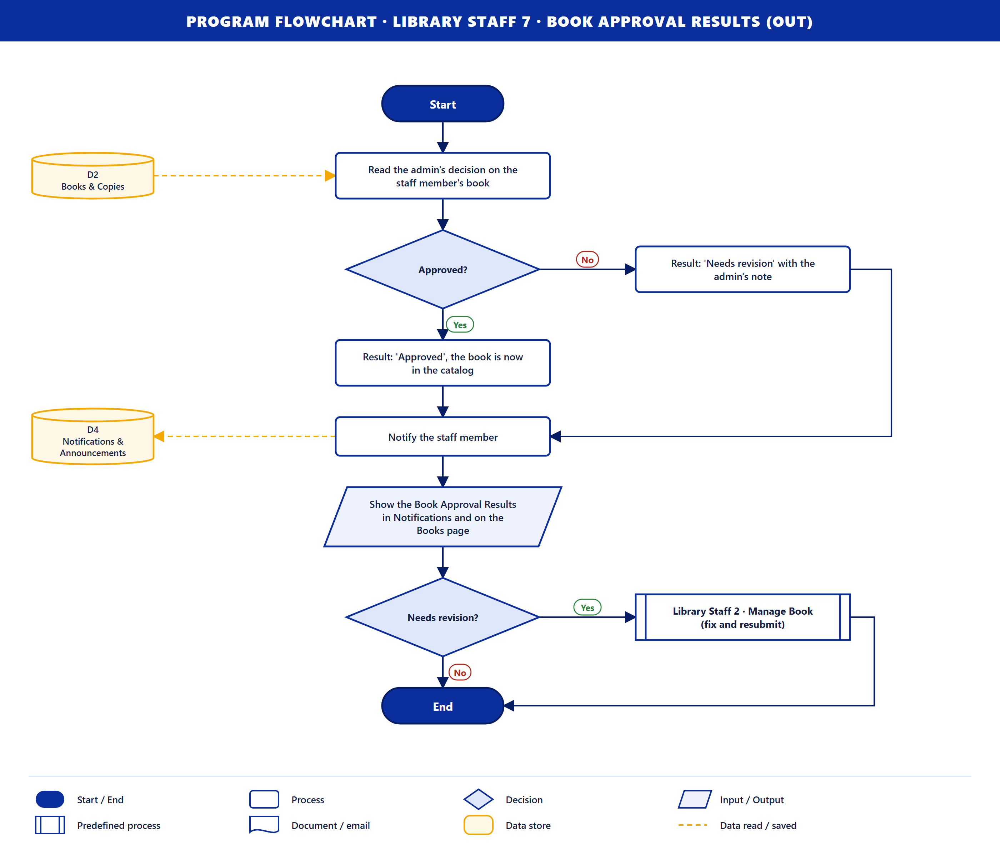

**Purpose.** The system tells the staff member what the admin decided about their book.

**How it works**

1. The admin's decision is read from **D2**.
2. **Approved?** Yes: the result is "Approved", the book is in the catalog. No: the result is "Needs revision" with the admin's note.
3. The staff member is notified (**D4**), and the result shows in Notifications and on the Books page.
4. **Needs revision?** If yes, **Library Staff 2 · Manage Book** runs so they can fix and resubmit it.

**Data stores.** D2 (read), D4 (save).

## Library Staff 8 · Generated Reports (out)

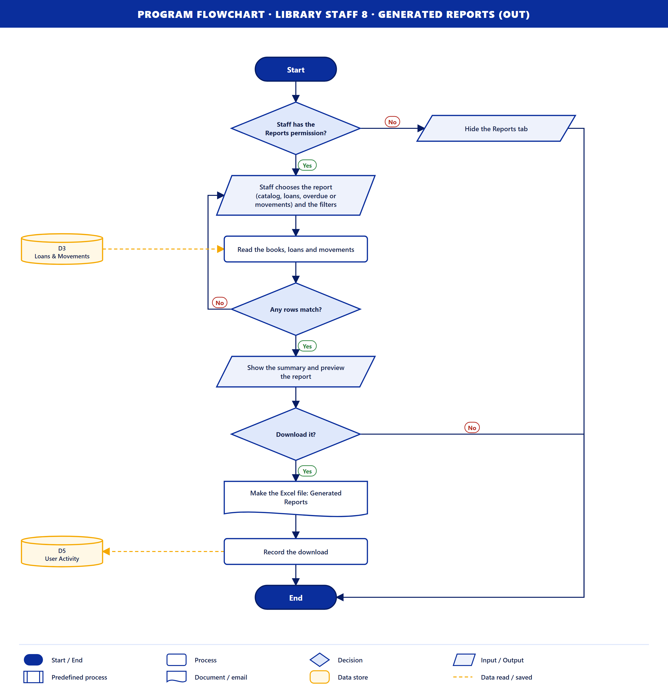

**Purpose.** The system makes a library report for staff.

**How it works**

1. **Staff has the Reports permission?** If not, the Reports tab is hidden.
2. Staff choose the report (catalog, loans, overdue or movements) and the filters.
3. The data is read from **D3**. If no rows match, they change the filters (loop).
4. The summary and a preview are shown. **Download it?** If yes, the Excel file is made and the download is recorded in **D5**.

**Data stores.** D3 (read), D5 (save).

---

# Part 3. Administrator (7 flowcharts)

## Administrator 1 · Login Credentials (in)

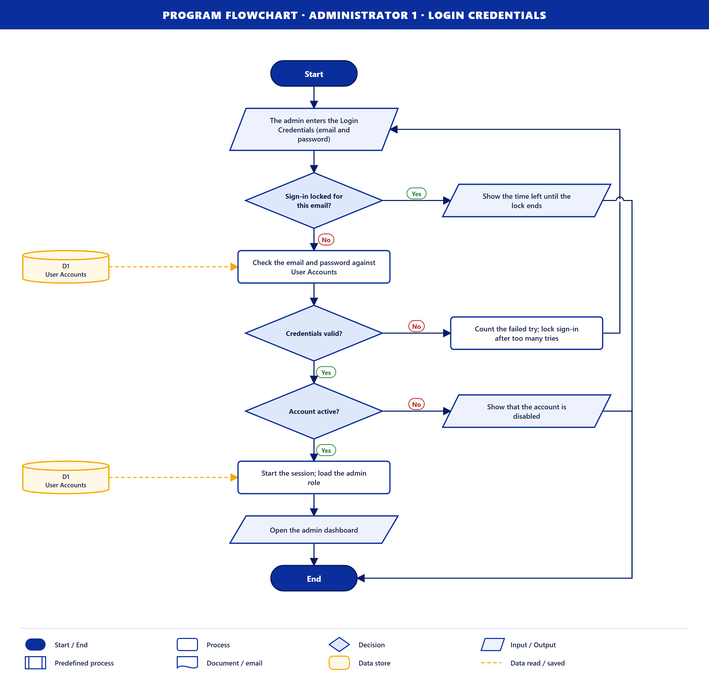

**Purpose.** The admin signs in. The steps are the same as Student 2; the admin role is loaded from **D1** and the admin dashboard opens.

**Data stores.** D1 (read).

## Administrator 2 · Book Manage Request (in)

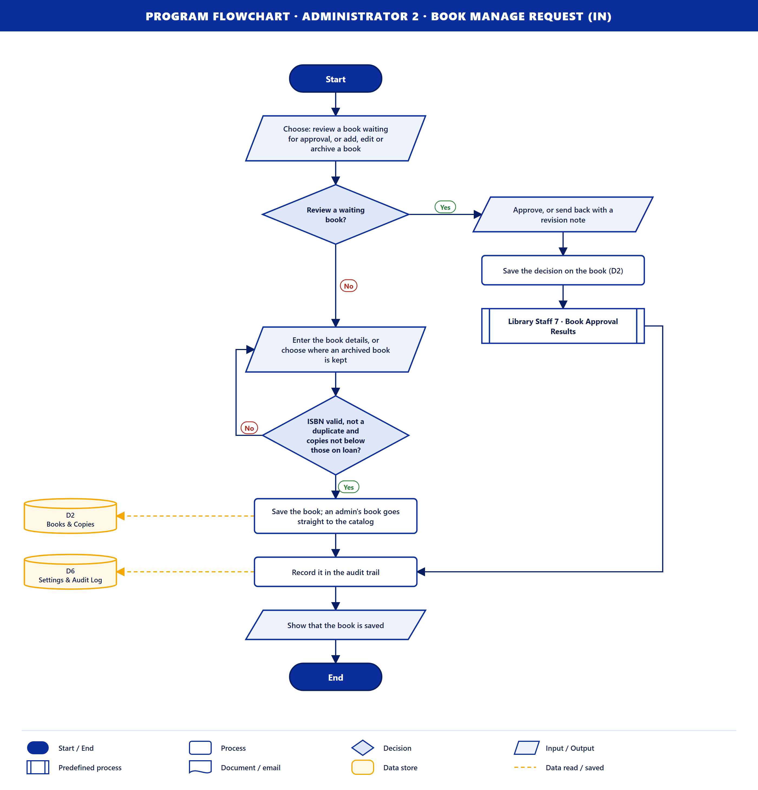

**Purpose.** The admin decides on a book a staff member added, or manages a book directly.

**How it works**

1. The admin chooses to review a waiting book, or to add, edit or archive one.
2. **Review a waiting book?** If yes, the admin approves it or sends it back with a revision note. The decision is saved in D2 and **Library Staff 7 · Book Approval Results** runs.
3. Otherwise the admin enters the book details. **ISBN valid, not a duplicate and copies not below those on loan?** If not, they correct them (loop).
4. The book is saved to **D2**. An admin's book goes straight to the catalog with no approval step.
5. The action is recorded in the audit trail in **D6**, and the system shows that it is saved.

**Data stores.** D2 (save), D6 (save).

## Administrator 3 · Manage Users & Permission (in)

**Purpose.** The admin manages user accounts and staff permissions.

**How it works**

1. The admin opens the Students or Staff page.
2. **Add a staff member?** If yes, the account is found by email and made staff.
3. Otherwise the admin chooses a user. **Disable, enable or change the role?** If yes, the change is saved to D1.
4. For staff, the admin ticks the permissions: students, game, system, reports and audit. They are saved to **D1**.
5. The change is recorded in **D6**, and the updated list is shown.

**Data stores.** D1 (save), D6 (save).

## Administrator 4 · Book Manage Request (out)

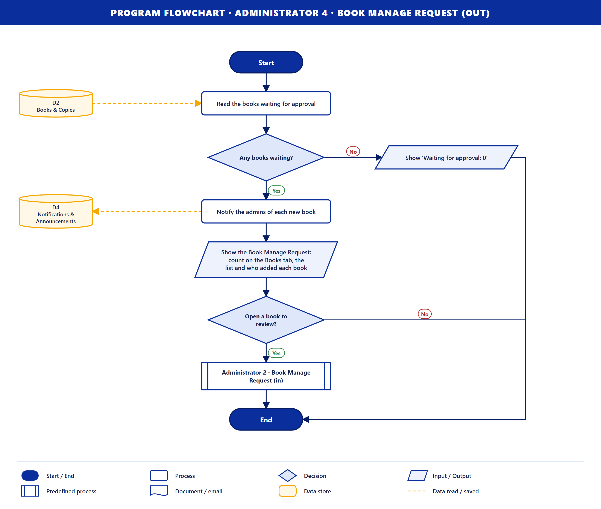

**Purpose.** The system shows the admin the books waiting for a decision.

**How it works**

1. The books waiting for approval are read from **D2**. If there are none, "Waiting for approval: 0" is shown.
2. The admins are notified of each new book (**D4**).
3. The list is shown with the count on the Books tab and who added each book.
4. **Open a book to review?** If yes, **Administrator 2 · Book Manage Request (in)** runs.

**Data stores.** D2 (read), D4 (save).

## Administrator 5 · Analytics Dashboard (out)

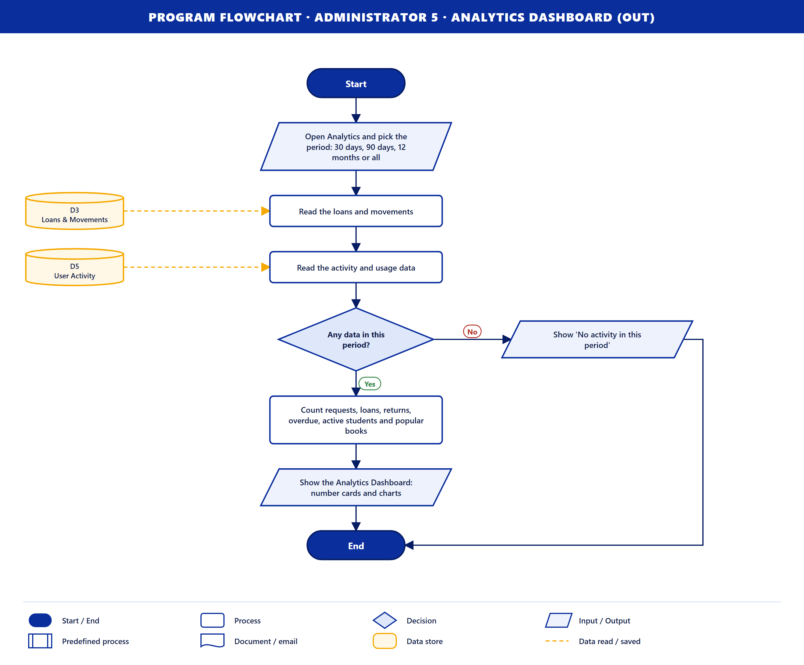

**Purpose.** The system shows the admin how the library is being used.

**How it works**

1. The admin opens Analytics and picks the period: 30 days, 90 days, 12 months or all.
2. The loans and movements are read from **D3**, and the activity data from **D5**.
3. **Any data in this period?** If not, "No activity in this period" is shown.
4. The system counts requests, loans, returns, overdue books, active students and popular books, and shows them as number cards and charts.

**Data stores.** D3 (read), D5 (read).

## Administrator 6 · Audit Trail Logs (out)

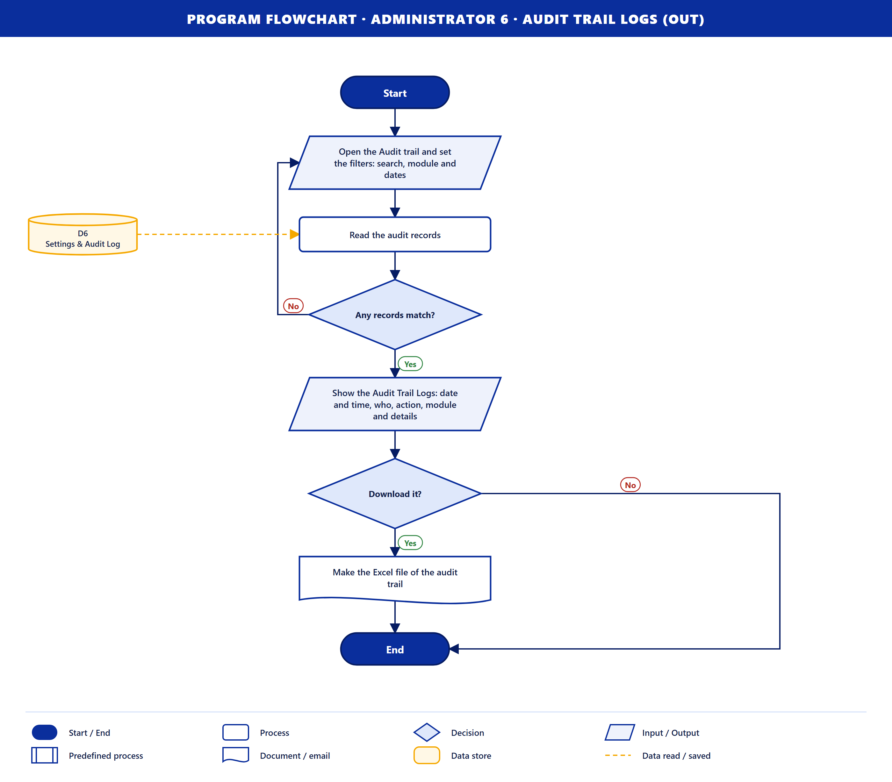

**Purpose.** The system shows the admin who did what in the system.

**How it works**

1. The admin opens the Audit trail and sets the filters: search, module and dates.
2. The audit records are read from **D6**. If nothing matches, the admin changes the filters (loop).
3. The logs are shown: date and time, who, action, module and details.
4. **Download it?** If yes, an Excel file of the audit trail is made.

**Data stores.** D6 (read).

## Administrator 7 · Generated Reports (out)

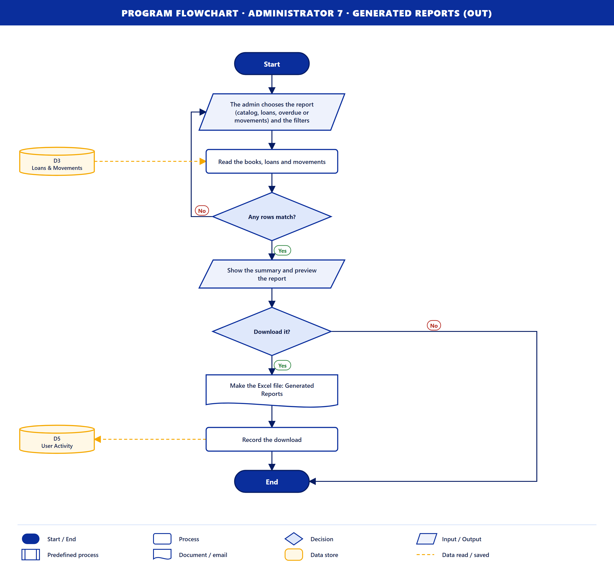

**Purpose.** The system makes a library report for the admin. The steps are the same as Library Staff 8, except that the admin always has access to reports, so there is no permission check.

**Data stores.** D3 (read), D5 (save).

---

## Summary

| No. | Flowchart | User | Direction | Data stores | What the user gets |
|---|---|---|---|---|---|
| 1 | Registration Details | Student | in | D6, D1 | New account |
| 2 | Login Credentials | Student | in | D1 | Session and catalog |
| 3 | View Catalog | Student | in | D2 | Book list and details |
| 4 | Borrow Request | Student | in | D3 | Reserved copy |
| 5 | Request Cancellation | Student | in | D3 | Cancelled request and email |
| 6 | 2D-3D Library Game | Student | out | D6, D1 | The game, signed in |
| 7 | Pickup QR Ticket | Student | out | D3 | QR ticket on the site, in the game and by email |
| 8 | Due Dates & Overdue Fines | Student | out | D3, D6 | Due dates and fines in My books |
| 9 | Notifications & Email Reminders | Student | out | D3, D4 | Notifications and emails |
| 10 | Login Credentials | Library Staff | in | D1 | Session and staff dashboard |
| 11 | Manage Book | Library Staff | in | D2, D6 | Book saved, waiting for approval |
| 12 | Pickup QR Scan (Checkout) | Library Staff | in | D3 | Book checked out with due dates |
| 13 | Book Returns | Library Staff | in | D3 | Return, fine and receipt |
| 14 | Pending Borrow Requests | Library Staff | out | D3 | List of requests waiting for pickup |
| 15 | Circulation & Movement Records | Library Staff | out | D3 | Loan and movement history |
| 16 | Book Approval Results | Library Staff | out | D2, D4 | Approved or needs revision |
| 17 | Generated Reports | Library Staff | out | D3, D5 | Excel report |
| 18 | Login Credentials | Administrator | in | D1 | Session and admin dashboard |
| 19 | Book Manage Request | Administrator | in | D2, D6 | Decision or saved book |
| 20 | Manage Users & Permission | Administrator | in | D1, D6 | Updated users and permissions |
| 21 | Book Manage Request | Administrator | out | D2, D4 | Books waiting for a decision |
| 22 | Analytics Dashboard | Administrator | out | D3, D5 | Number cards and charts |
| 23 | Audit Trail Logs | Administrator | out | D6 | Audit log and Excel file |
| 24 | Generated Reports | Administrator | out | D3, D5 | Excel report |

The flowcharts are drawn by `tools/make-program-flowcharts.mjs`. To change a step, edit its list in that file and run `node tools/make-program-flowcharts.mjs`; every chart is redrawn into `docs/program-flowcharts/`.
